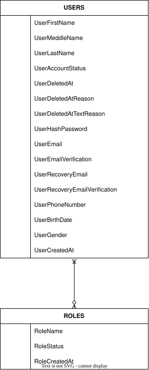
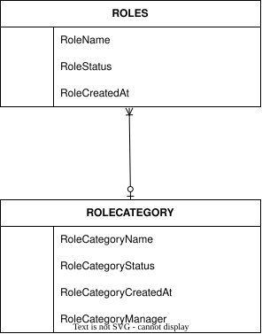
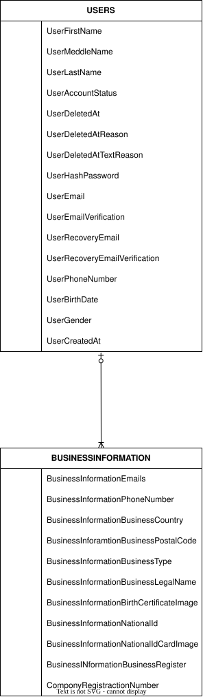
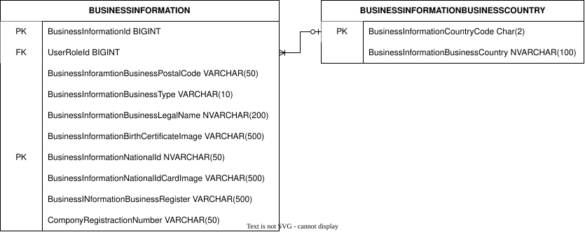
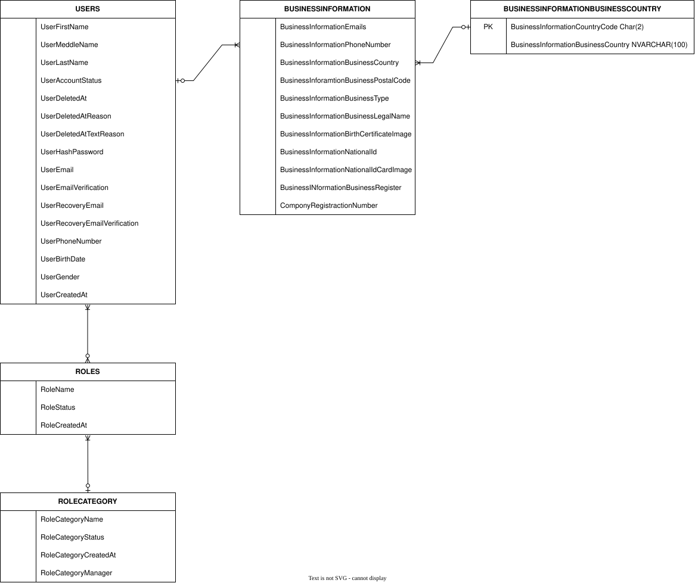
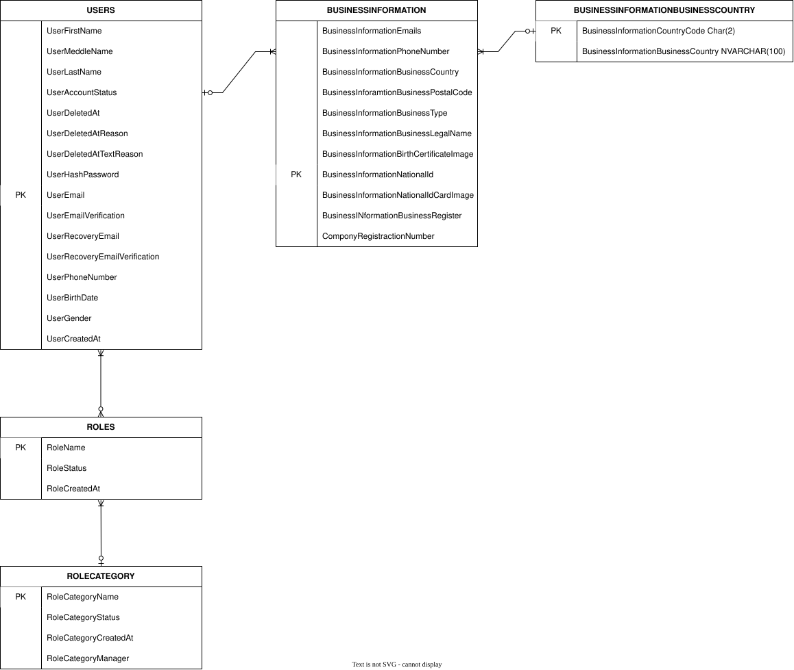

# USER-DOMAIN — Relationships and Basic Keys Documentation

## 1. Overview

**Domain:** `USER-DOMAIN`  
**Stage:** Relationships and Basic Keys  
**Scope:** Relationship Identification, Cardinality, Participation, Business Rationale, and Initial Basic Key Identification.

This document defines the relationships between the `USERS`, `ROLES`, `ROLE_CATEGORIES`, and `BUSINESS_INFORMATION` tables.

It also identifies the initial Basic Keys used temporarily during the initial First Normal Form (1NF) stage.

The relationships and keys are documented according to the current business rules and design decisions. Their physical implementation, final key selection, and detailed resolution will be addressed in the relevant design stages.

---

# Part I — Relationship Documentation

## 2. Relationship 1: USERS and ROLES

### 2.1 Relationship Purpose

This relationship represents the roles assigned to users within the system.

A registered user may hold multiple roles simultaneously, and the system may contain multiple users assigned to the same role.

For example, a user may be classified as both a `System Visitor` and a `System Employee`, while a particular role may be assigned to many different users.

### 2.2 Business Rules

**BR-001:** A registered user may be assigned multiple roles simultaneously.

### 2.3 Cardinality

This relationship is **Many-to-Many (M:N)**.

- One user may be assigned multiple roles.
- One role may be assigned to multiple users.

### 2.4 Participation

**From the USERS side: Mandatory**

Every user must be assigned at least one role, even if that role is the only role assigned to the user. The customer classification is an example of a role that can satisfy this requirement.

**From the ROLES side: Optional**

A role may exist without being assigned to any users. For example, a newly created role may not yet have any assigned users, or a role may be defined before the system launches.

### 2.5 Relationship Summary

| Entity | Minimum Participation | Maximum Participation |
|---|---:|---:|
| `USERS` | 1 | Many |
| `ROLES` | 0 | Many |

### 2.6 Expected Impact

This relationship supports users with multiple roles and roles shared by multiple users.

It also establishes that every user must have at least one role, while allowing role definitions to exist before any users are assigned to them.

The implementation of this many-to-many relationship will be addressed in the `Relationship Solution` stage.

---

## 3. Relationship 2: ROLES and ROLE_CATEGORIES

### 3.1 Relationship Purpose

This relationship classifies each role under a role category.

Role categories provide a way to organize related roles into meaningful groups. A category may contain multiple roles, while each role must belong to exactly one category.

### 3.2 Cardinality

This relationship is **One-to-Many (1:N)** from `ROLE_CATEGORIES` to `ROLES`.

- One role category may contain multiple roles.
- One role must belong to exactly one role category.
- A role cannot belong to multiple categories simultaneously under the current business rules.

### 3.3 Participation

**From the ROLES side: Mandatory**

Every role must be associated with exactly one category, including newly created roles.

A role cannot exist without a category.

**From the ROLE_CATEGORIES side: Optional**

A category may exist without containing any roles. For example, a newly created category may not yet have any roles assigned to it.

### 3.4 Relationship Summary

| Entity | Minimum Participation | Maximum Participation |
|---|---:|---:|
| `ROLES` | 1 | 1 |
| `ROLE_CATEGORIES` | 0 | Many |

### 3.5 Expected Impact

This relationship ensures that roles are organized under defined categories while allowing categories to be created before roles are assigned to them.

It also establishes that each role has one specific category, preventing a role from being classified under multiple categories simultaneously.

The implementation of this relationship will be addressed in the `Relationship Solution` stage.

---

## 4. Relationship 3: USERS and BUSINESS_INFORMATION

### 4.1 Relationship Purpose

This relationship connects users to their business information profiles.

According to the following business rules, business information is maintained separately from common user account information, and only roles requiring business information shall be associated with business profiles.

**BR-010:** Business information shall be maintained separately from the User entity.

**BR-011:** Only roles requiring business information shall be associated with business profiles.

A user may have multiple roles, and different roles may require business information. Consequently, a user may be associated with multiple business information profiles.

### 4.2 Cardinality

This relationship is **One-to-Many (1:N)** from `USERS` to `BUSINESS_INFORMATION`.

- One user may be associated with multiple business information profiles.
- Each business information profile must belong to exactly one user.

### 4.3 Participation

**From the USERS side: Optional**

A user may have no business information profile if none of their assigned roles requires one.

A user may also have multiple business information profiles when their assigned roles require business information.

**From the BUSINESS_INFORMATION side: Mandatory**

Every business information profile must be associated with exactly one user.

A business information profile cannot exist independently of its associated user.

### 4.4 Relationship Summary

| Entity | Minimum Participation | Maximum Participation |
|---|---:|---:|
| `USERS` | 0 | Many |
| `BUSINESS_INFORMATION` | 1 | 1 |

### 4.5 Expected Impact

This relationship separates common account information from business-specific information and allows business profiles to exist only where required.

It also supports users who have multiple roles requiring business information, without requiring every user to have a business profile.

The specific roles that require business information will be identified in a separate document, as determined by the current design plan.

The implementation of this relationship will be addressed in the `Relationship Solution` stage.

---

### EC-BI-001: Country Separation into a Reference Table

**Related Document:** `006-DATABASE-USER-MODULE-EDGECASES-AND-SOLUTION`

**Status:** Accepted — Separate `BUSINESS_INFORMATION_COUNTRY` Table.

#### Relationship and Cardinality

The relationship between `BUSINESS_INFORMATION_COUNTRY` and `BUSINESS_INFORMATION` is **One-to-Many (1:N)**.

- **BUSINESS_INFORMATION_COUNTRY:** Optional participation (0..N). A country record may exist without being referenced by any business information record.
- **BUSINESS_INFORMATION:** Mandatory participation (1..1). Every business information record must reference exactly one country record through `CountryCode`.

#### Relationship Explanation

This relationship was established after identifying and resolving the country-related edge case documented in `006-DATABASE-USER-MODULE-EDGECASES-AND-SOLUTION`.

The country attribute was separated from `BUSINESS_INFORMATION` into a dedicated reference table to maintain consistent country names and codes and avoid storing country information repeatedly.

As a result, each `BUSINESS_INFORMATION` record must reference an existing country, while a country can exist in the reference table without having any associated business information records.

#### Referential Implementation

- `BUSINESS_INFORMATION.CountryCode` is `NOT NULL`.
- `BUSINESS_INFORMATION.CountryCode` references `BUSINESS_INFORMATION_COUNTRY.CountryCode` through a Foreign Key.
- The Foreign Key uses `ON UPDATE NO ACTION` and `ON DELETE NO ACTION`.

---

## 5. Consolidated Relationship Summary

| Relationship | Cardinality | Participation Rule |
|---|---|---|
| `USERS` — `ROLES` | Many-to-Many | Every user must have at least one role; a role may have no users. |
| `ROLE_CATEGORIES` — `ROLES` | One-to-Many | Every role must belong to exactly one category; a category may have no roles. |
| `USERS` — `BUSINESS_INFORMATION` | One-to-Many | A user may have no business profiles or multiple profiles; every profile must belong to exactly one user. |

---

# Part II — Basic Keys for the Initial 1NF Stage

## 6. Purpose of Basic Keys

At this stage, we will use **Basic Keys** as temporary identifiers for the entities in our domain. These keys are intended to help us organize the tables and handle multivalued attributes while working toward First Normal Form (1NF).

**Important:** These are not the final primary keys of the database. They are temporary identifiers that may change once we analyze the functional dependencies and finalize the data model.

Our current approach is to establish 1NF before analyzing functional dependencies. Therefore, we need simple, unique identifiers to reference records and organize the data during this initial stage.

## 7. Basic Keys for Each Table

### 7.1 USERS Table

- **Basic Key:** `UserEmail`

We will temporarily use `UserEmail` as the basic identifier for the `USERS` table because it is expected to be unique for each user and can identify an individual record.

### 7.2 ROLES Table

- **Basic Key:** `RoleName`

We will temporarily use `RoleName` as the basic identifier for the `ROLES` table, assuming that each role has a unique name.

### 7.3 ROLE_CATEGORIES Table

- **Basic Key:** `RoleCategoryName`

We will temporarily use `RoleCategoryName` as the basic identifier for the `ROLE_CATEGORIES` table, assuming that each category name uniquely identifies a category.

### 7.4 BUSINESS_INFORMATION Table

- **Basic Key:** `BusinessInformationNationalId`

We will temporarily use `BusinessInformationNationalId` as the basic identifier for the `BUSINESS_INFORMATION` table, assuming that each national ID uniquely identifies a business information record.

## 8. Why Are We Using Basic Keys?

The main reason for introducing these keys is to maintain a clear structure while handling multivalued attributes during the initial normalization stage.

Since our current workflow prioritizes 1NF before functional dependency analysis, we need identifiers that allow us to reference the original records when separating multivalued attributes into different tables.

These Basic Keys help us:

- Identify records during the initial design stage.
- Maintain references between tables when separating multivalued attributes.
- Organize the schema before determining the final keys.
- Make it easier to revise the model as we proceed with normalization.

## 9. Why Did We Choose These Specific Attributes?

We selected these attributes because they are expected to be unique within their respective tables and can therefore serve as temporary record identifiers.

However, **uniqueness at this stage does not automatically make an attribute the final primary key**. Each attribute must be validated against the actual business rules and data constraints.

For example, `UserEmail` may be unique under the current requirements, but we may later decide to introduce a surrogate key such as `UserId`.

The same principle applies to the other tables.

## 10. Relationship Between Basic Keys and Functional Dependencies

Once we complete the initial 1NF stage, we will analyze the functional dependencies within each table.

This analysis will help us determine:

- The actual candidate keys.
- The appropriate primary key for each table.
- Whether any attributes should be replaced by surrogate keys.
- Whether additional decomposition is required to achieve higher normal forms.

The final key design must be based on the functional dependencies, candidate keys, and business rules rather than on our initial assumptions alone.

It is also important to note that functional dependencies do not necessarily produce a new key in every case. They help us identify the candidate keys and understand the relationships between attributes.

## 11. Can Basic Keys Change Later?

**Yes. These keys are temporary and can be changed.**

For example, we may replace a natural key such as `UserEmail` with a surrogate key such as `UserId` after completing the analysis.

This is an expected part of the design process. The purpose of the current keys is to support the initial table structure, not to lock us into a final database design.

We will finalize the keys only after reviewing the functional dependencies and validating the complete domain model.

## 12. Final Clarification

To avoid any misunderstanding, the attributes listed above are **Basic Keys for the initial 1NF stage, not the confirmed final primary keys**.

We are using them because they are expected to be unique and can temporarily identify records while we organize the tables and handle multivalued attributes.

After completing 1NF, we will analyze the functional dependencies and determine the appropriate candidate keys and final primary keys. If necessary, we will introduce surrogate keys or revise the existing identifiers.

**The objective is to establish a workable initial structure without making premature decisions about the final key design.**

---

# Part III — Scope and Future Decisions

## 13. Scope and Future Decisions

This document records the current relationship requirements and initial Basic Key decisions.

The following topics remain assigned to their designated stages:

- **Advanced Keys and Description:** Identification and documentation of the relevant keys.
- **Relationship Solution:** Determining how the relationships will be implemented.
- **Functional Dependencies:** Analyzing the functional dependencies associated with the entities and relationships.
- **Normalization:** Evaluating the database structure and normalization requirements.
- **Edge Cases and Edge Case Solutions:** Examining exceptional scenarios and defining their solutions.
- **Data Types and Constraints:** Defining the appropriate implementation details and enforcement rules.
- **Lifecycle and Decision Finalization:** Finalizing lifecycle behavior and resolving outstanding design decisions.
- **Indexing Basics:** Documenting indexing decisions.

The relationships and Basic Keys documented here represent the current design decisions and assumptions.

Any required changes will be reviewed in the appropriate stage rather than assumed in advance.

