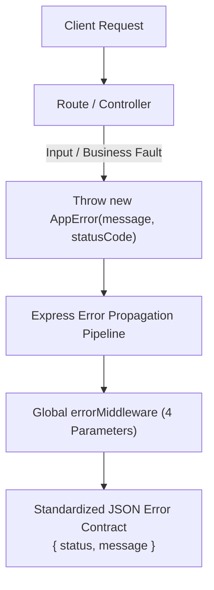

# 🏛️ Multi-Seller Marketplace — Backend Architecture & Engineering Documentation
**Domain:** `USER-DOMAIN (Backend Implementation)`  
**Version:** `1.0.0`  
**Status:** `Days 1-3 Completed & Verified`  

---

## 1. Executive Summary & Tech Stack Overview

This document provides a comprehensive technical overview of the backend architecture built for the **Multi-Seller Marketplace**, directly reflecting and implementing the database design, functional dependencies, and business constraints documented in the `USER-DOMAIN`.

### Selected Core Technologies:
* **Runtime Environment:** `Node.js` (LTS)
* **API Framework:** `Express.js 5.3` (Next-generation request pipeline with native async error propagation)
* **Database Engine:** `Microsoft SQL Server` (Local instance on port 1433)
* **Object-Relational Mapping (ORM):** `Prisma ORM 6.19` (Type-safe client with schema migrations & query engine)
* **Schema Validation Engine:** `Zod 4.6` (Strict runtime schema enforcement for HTTP request payloads)
* **Cryptographic & Auth Security:** `bcryptjs 3.0` & `jsonwebtoken 9.0`
* **Network & Serialization Utilities:** `cors 2.8`, `dotenv 18.0`

---

## 2. Layered Architecture Design (Clean Separation of Concerns)

The backend strictly adheres to a **Separation of Concerns (SoC)** layered architecture to ensure modularity, maintainability, and horizontal scalability:

```
backend/
├── src/
│   ├── config/             # Database connection & third-party client singletons (Prisma)
│   ├── controllers/        # Request handling, orchestration, & HTTP response generation
│   ├── services/           # Core business logic, DB transactions, & mathematical operations
│   ├── routes/             # RESTful route definitions & middleware pipeline binding
│   ├── middlewares/        # Interceptors: Authentication, Authorization, Validation, Error Handling
│   ├── models/             # ORM models, types, and DB interfaces
│   ├── validations/        # Strict input validation schemas (Zod)
│   ├── utils/              # Operational error wrappers, formatting helpers, and utilities
│   ├── app.js              # Express application assembly, global middlewares, & routing tables
│   └── server.js           # Server bootstrap, environment injection, & port listener
├── prisma/
│   ├── schema.prisma       # Physical database schema mapping (8 models)
│   └── seed.js             # Initial database seeding script (Roles & Categories)
└── .env                    # Environment configuration (Ignored in Git)
```

---

## 3. Database Layer Implementation (`USER-DOMAIN`)

All 8 models defined in the database design pipeline were converted into physical tables on SQL Server via Prisma Client:

### Implemented Tables:
1. **`USERS`**: Central identity table holding common account attributes, soft-delete metadata, gender, and status flags.
2. **`USERPHONENUMBER`**: Multi-valued telephone numbers (1NF normalization) with verification states.
3. **`ROLE_CATEGORIES`**: Classification groups (`System Visitor`, `System Employee`, `Seller Operations`).
4. **`ROLES`**: Distinct system roles (`CUSTOMER`, `SELLER`, `STORE_MANAGER`, `SYSTEM_ADMIN`).
5. **`USER_ROLE`**: Surrogate-keyed junction table resolving the M:N relationship between `USERS` and `ROLES`.
6. **`BUSINESS_INFORMATION`**: 1:1 business profile attached specifically to a user's role assignment (`USER_ROLE`).
7. **`BUSINESS_INFORMATION_EMAIL`**: Multi-valued business contact emails with composite primary keys.
8. **`BUSINESS_INFORMATION_PHONENUMBER`**: Multi-valued business phone numbers.

### Key Database Level Enforcements:
* **Active Role Constraint:** Enforced via a **Filtered Unique Index** in SQL Server:
  ```sql
  CREATE UNIQUE INDEX UX_UserRole_ActiveNow 
  ON USER_ROLE (UserId) 
  WHERE UserRoleActiveNow = 1;
  ```
  *Guarantee:* A user can hold multiple roles simultaneously, but can NEVER have more than one active role session (`ActiveNow = 1`) across the database.
* **BigInt Serialization:** Implemented a global serialization polyfill in `src/app.js` (`BigInt.prototype.toJSON`) ensuring SQL Server `BIGINT` primary keys serialize cleanly to JSON responses without runtime exceptions.

---

## 4. Centralized Error Handling Architecture

Instead of handling errors in ad-hoc `try/catch` blocks across controllers, the system implements an enterprise-grade **Centralized Error Handling Pattern**:



### 1. `AppError` (`src/utils/AppError.js`)
An operational error wrapper extending the native JavaScript `Error` class:
* Encapsulates `statusCode` (e.g., 400, 401, 403, 404).
* Dynamically infers `status`: `'fail'` for 4xx client errors, `'error'` for 5xx server bugs.
* Flags `isOperational = true` to differentiate expected business errors from unexpected runtime crashes.
* Captures a pristine stack trace while isolating the constructor to keep logs clean.

### 2. `errorMiddleware` (`src/middlewares/errorMiddleware.js`)
The terminal middleware in `app.js` with signature `(err, req, res, next)`:
* Acts as the single security perimeter and response formatter.
* Normalizes uncaught exceptions to HTTP 500 while preserving operational error metadata.
* Guarantees a consistent JSON contract for API consumers:
  ```json
  {
    "status": "fail",
    "message": "First name must be at least 2 characters long"
  }
  ```

---

## 5. Request Pipeline & Input Validation Layer

To enforce the strict data constraints documented in `008-CONSTRAINTS` before any payload hits the database, a dedicated validation layer is placed at the HTTP gateway:

### 1. Validation Schemas (`src/validations/authValidation.js`)
Built using `Zod` to reflect physical schema rules:
* `userFirstName` / `userLastName`: Required strings, trimmed, minimum 2 characters.
* `userEmail`: Strict email formatting, trimmed.
* `password`: Minimum 8 characters.
* `userPhoneNumber`: Trimmed string enforcing the international country code constraint (`.startsWith('+')`).

### 2. Generic Validation Middleware (`src/middlewares/validate.js`)
Implemented as a **Higher-Order Middleware Factory**:
```javascript
const validate = (schema) => (req, res, next) => { ... }
```
* Safely parses `req.body` using `schema.safeParse()`.
* **On Failure:** Intercepts the first validation issue and immediately delegates to `next(new AppError(errorMessage, 400))`.
* **On Success:** Injects the sanitized, trimmed data back into `req.body` and proceeds to the controller via `next()`.
* Reusable across the entire application for any future domain (Stores, Products, Orders).

---

## 6. Endpoints Catalog & Routing Table

| Method | Endpoint | Access | Middlewares | Description |
|---|---|---|---|---|
| `GET` | `/api/health` | Public | None | Database connectivity verification (`SELECT 1;`) |
| `POST` | `/api/auth/register` | Public | `validate(registerSchema)` | Validates payload, prepares transaction for user/phone/role creation |
| `POST` | `/api/auth/login` | Public | `validate(loginSchema)` | *(Day 4)* Authentication, status check, & JWT issuance |

---

## 7. Business Rules Compliance Audit

| Rule ID | Architectural Requirement | How It Is Implemented |
|---|---|---|
| **BR-001** | Multi-Role assignment per user | `USER_ROLE` junction model mapped in Prisma |
| **BR-002** | Simultaneous visitor & employee roles | Categorized via `ROLE_CATEGORIES` seeded in DB |
| **BR-003** | Independent role lifecycles | `UserRoleStatus` column separated from `UserAccountStatus` |
| **BR-010** | Business Info linked to role (not user) | `BUSINESS_INFORMATION` has 1:1 foreign key to `USER_ROLE` |
| **Phone Constraint** | Phone numbers must start with `+` | Enforced at gateway via `authValidation.js` + DB schema |
| **Active Context** | Exactly one active role at a time | Enforced via SQL Server Filtered Unique Index |

---

## 8. Next Milestones (Day 4 Roadmap)
1. **Password Hashing:** Asynchronous hashing via `bcryptjs` (salt rounds: 12).
2. **Atomic Registration Transaction:** Multi-table insertion (`USERS` + `USERPHONENUMBER` + `USER_ROLE`) inside a single `prisma.$transaction`.
3. **Stateless Authentication:** JWT token generation containing `userId`, active `roleId`, and `roleName`.
4. **Login Endpoint:** Account status guarding (preventing `DELETED`, `BLOCKED`, or `SUSPENDED` logins).
